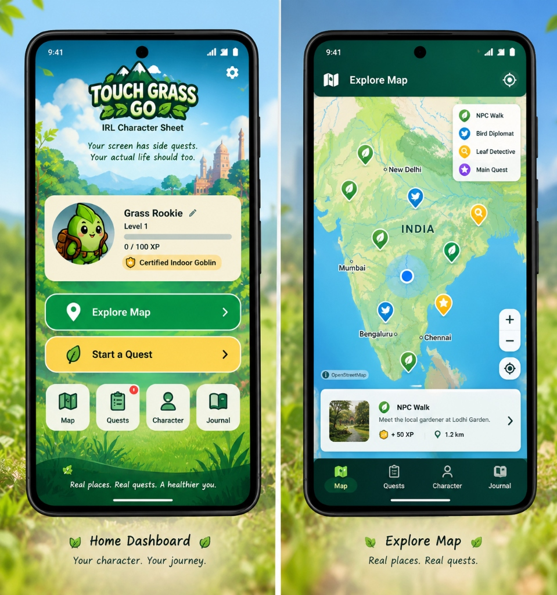
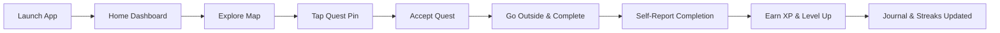

# TOUCH GRASS GO — IRL Character Sheet

<p align="center">
  
</p>

<p align="center">
  <em><strong>"Your screen has side quests. Your actual life should too."</strong></em>
</p>

<p align="center">
  <a href="https://github.com/AdityaAlibade/touch-grass-go"></a>
  
  
  
  
  
  <a href="https://github.com/AdityaAlibade/touch-grass-go/issues"></a>
</p>

---

## Table of Contents

- [App Preview](#app-preview)
- [Project Overview](#project-overview)
- [Key Features & Implementation Status](#key-features--implementation-status)
- [Technology Stack](#technology-stack)
- [Project Structure](#project-structure)
- [Prerequisites](#prerequisites)
- [Download & Installation](#download--installation)
- [Setup & Run in Android Studio](#setup--run-in-android-studio)
- [Build & Test from the Command Line](#build--test-from-the-command-line)
- [Installing the APK](#installing-the-apk)
- [How to Use the App](#how-to-use-the-app)
- [Permissions, Configuration & Privacy](#permissions-configuration--privacy)
- [Testing & Quality Assurance](#testing--quality-assurance)
- [Troubleshooting Guide](#troubleshooting-guide)
- [Roadmap](#roadmap)
- [Contributing](#contributing)
- [Support & Acknowledgements](#support--acknowledgements)

---

## App Preview

> [!NOTE]
> The preview below shows promotional UI design mockups illustrating the visual target for the Home Dashboard and Explore Map screens. While the core features, buttons, dialogs, and map layers are implemented in native Android views, the running app's styling continues to evolve toward this design target.

<p align="center">
  
</p>

*Figure 1: Design previews of the Home Dashboard (left) featuring character progression and quick actions, and the Explore Map (right) centered on India with interactive quest pins and quest cards.*

---

## Project Overview

### The Problem
Modern life revolves around glowing glass rectangles. Between desktop workstations, social media feeds, and mobile gaming, screen fatigue and indoor sedentary habits are at an all-time high. Traditional wellness apps often feel like clinical chore lists or guilt-inducing timers.

### The Solution
**Touch Grass Go** turns the physical outdoors into a real-life Role-Playing Game (RPG). Drawing playful inspiration from location-based adventure games like *Pokémon GO* while maintaining 100% original outdoor mindfulness branding, Touch Grass Go equips players with an **IRL Character Sheet**:

- **Real-World Quests:** Micro-adventures encouraging mindfulness, bird listening, photography, and gentle urban strolls.
- **Measurable Progression:** Earn XP for touching grass, level up from a lowly *"Grass Rookie"*, and unlock humorous titles like *"Certified Indoor Goblin"* and *"Pigeon Diplomat"*.
- **Daily Adventure Journal:** Chronicle completed quests with timestamps, XP records, and personal reflections.
- **Daily Streaks:** Build healthy habits by venturing outside consistently day after day.
- **Safe AI Quests:** Generate personalized outdoor activities tailored to your available time and surroundings using open-weight Gemma model integrations with built-in safety boundaries.

---

## Key Features & Implementation Status

| Feature | Category | Description | Status |
| :--- | :--- | :--- | :--- |
| **Splash & Dashboard** | Core UI | 1.4-second branded splash transition leading to character card, XP bar, level badge, and daily streak overview. | ✅ Implemented & Verified |
| **Interactive Map** | Navigation | OpenStreetMap integration powered by `Osmdroid` centered on India (20.5937° N, 78.9629° E) with zoom controls and offline status detection. | ✅ Implemented & Verified |
| **GPS Location Overlay** | Navigation | Optional "My Location" button requesting runtime permissions and centering map with `MyLocationNewOverlay`. | ✅ Implemented & Verified |
| **Quest Discovery** | Quests | Status-coded map markers (Available, Active, Completed) anchored to Indian landmarks (e.g., Cubbon Park, Lodhi Garden, Sanjay Gandhi National Park). | ✅ Implemented & Verified |
| **Quest Lifecycle** | Quests | Full lifecycle management (`AVAILABLE` &rarr; `ACTIVE` &rarr; `COMPLETED`) with interactive details dialog and self-reported confirmation. | ✅ Implemented & Verified |
| **XP & Level Progression** | Progression | Deterministic XP thresholds (Level 1 at 0 XP, Level 2 at 100 XP, Level 3 at 250 XP, Level 4 at 450 XP, Level 5 at 700 XP, +300 XP/level). | ✅ Implemented & Verified |
| **Humorous Titles** | Progression | Unlockable titles based on completed quests (*Certified Indoor Goblin*, *Certified Grass Toucher*, *Leaf Enthusiast*, *Pigeon Diplomat*, *Goblin Botanist*). | ✅ Implemented & Verified |
| **Avatar Selector** | Character | Switchable character avatars (*Goblin Shield*, *Grass Blade*, *Hero Sparkle*, *Compass Wanderer*) saved locally. | ✅ Implemented & Verified |
| **Adventure Journal** | History | Chronological log of completed quests with timestamps, XP badges, unlocked titles, and editable reflection notes. | ✅ Implemented & Verified |
| **Daily Streak Tracker** | Habits | Consecutive day tracking with automatic date boundary checks (`yyyy-MM-dd`) and longest streak record. | ✅ Implemented & Verified |
| **Room SQLite Database** | Storage | Robust offline persistence with Room 2.6.1 entities & DAOs with automated legacy migration without progress loss. | ✅ Implemented & Verified |
| **Local LLM Quest Engine** | AI / LLM | High-speed local LLM generation powered by `qwen2.5:3b` with fallback to `llama3.1:8b` and offline heuristic backup. | ✅ Implemented & Verified |
| **Quest Safety Validator** | AI / Safety | Keyword and rules-based filter preventing trespassing, foraging/tasting wild items, or dangerous crossings, with XP bounded to 15–50 XP. | ✅ Implemented & Verified |
| **GPS Proximity Geofencing**| Location | Real-world Haversine proximity checks with configurable radius (200m, 500m, 1000m, or relaxed mode). | ✅ Implemented & Verified |
| **Dark & Light Themes** | UI / Theme | Persistent theme switcher (*Dark Forest*, *Daylight Meadow*, *System Default*) with dynamic night map tile styling. | ✅ Implemented & Verified |
| **Unit Test Coverage** | QA | 6 unit test suites testing AI parsing, progression math, streak dates, journal, proximity, and themes. | ✅ Implemented & Verified |
| **Real-time Live GPS Tracking** | Navigation | Dynamic location tracking under active outdoor movement. | 🟡 Implemented (Awaiting field verification) |
| **Adventure Log Export (MD/PDF)** | Journal | Export character sheet and journey entries to Markdown and printable PDF. | 📋 Planned (Step 5) |
| **Automated UI Espresso Tests** | QA | End-to-end device automated UI tests. | 📋 Planned (Step 6) |

---

## Technology Stack

| Technology | Version / Spec | Purpose in Touch Grass Go |
| :--- | :--- | :--- |
| **Java** | OpenJDK 11 / 21 | Core application programming language (`sourceCompatibility = JavaVersion.VERSION_11`). |
| **Android SDK** | Compile: 35 / Min: 28 / Target: 35 | Target Android 15 (API 35) with broad backward compatibility to Android 9.0 Pie (API 28). |
| **Android Gradle Plugin** | AGP 9.4.1 | Android build system tooling and artifact packaging. |
| **Gradle Wrapper** | 9.6.0 | Build automation tool orchestrating tasks, dependencies, and compilation. |
| **ViewBinding** | Android Gradle Feature | Type-safe XML layout view binding via generated `ActivityMainBinding`. |
| **Material Components** | `1.12.0` | Material Design UI widgets (`MaterialButton`, `MaterialCardView`, Bottom Navigation). |
| **Osmdroid Android** | `6.1.20` | Native OpenStreetMap viewer (`MapView`, `Marker`, `MyLocationNewOverlay`) requiring no proprietary API keys. |
| **Room Database** | `2.6.1` | SQLite object mapping, DAOs, and seamless migration helper (`room-runtime`, `room-compiler`). |
| **Local LLM Engine** | Qwen 2.5 3B / Llama 3.1 | Local developer inference (`http://10.0.2.2:11434`) with structured JSON schema and offline fallback. |
| **JUnit 4** | `4.13.2` | Core JVM unit testing framework for domain and math logic. |

---

## Project Structure

```text
touch-grass-go/
├── .gitignore                          # Git ignore rules for Android Studio & Gradle
├── build.gradle.kts                    # Root build configuration
├── settings.gradle.kts                 # Project repository settings & module registry
├── gradle.properties                   # JVM args & AndroidX flags
├── gradlew / gradlew.bat               # Unix & Windows Gradle wrapper executables
├── gradle/
│   ├── libs.versions.toml              # Centralized Gradle version catalog (Room 2.6.1, Osmdroid, Material)
│   ├── gradle-daemon-jvm.properties    # Daemon JVM toolchain configuration
│   └── wrapper/
│       ├── gradle-wrapper.jar
│       └── gradle-wrapper.properties   # Gradle 9.6.0 distribution reference
├── docs/
│   └── images/
│       └── touch-grass-go-preview.png  # Promotional design mockup preview
└── app/
    ├── build.gradle.kts                # Application module configuration (SDK 35, dependencies)
    ├── src/
    │   ├── main/
    │   │   ├── AndroidManifest.xml     # Permissions (INTERNET, ACCESS_FINE_LOCATION) & launcher activity
    │   │   ├── java/com/example/touchgrass/
    │   │   │   ├── MainActivity.java                   # Single-activity controller managing tabs, map, themes & dialogs
    │   │   │   ├── ai/
    │   │   │   │   ├── AiQuestService.java             # Qwen 2.5 3B / Llama 3.1 HTTP inference client & fallback
    │   │   │   │   ├── QuestGenerationRequest.java     # User preference model (level, duration, environment)
    │   │   │   │   └── QuestSafetyValidator.java       # Safety rules filter & XP boundary sanitizer
    │   │   │   ├── avatar/
    │   │   │   │   └── AvatarManager.java              # Avatar selection and persistence
    │   │   │   ├── db/
    │   │   │   │   ├── AppDatabase.java                # Room database definition (SQLite)
    │   │   │   │   ├── DataMigrationHelper.java        # Non-destructive migration from SharedPreferences to Room
    │   │   │   │   ├── QuestEntity.java & QuestDao.java
    │   │   │   │   ├── JournalEntity.java & JournalDao.java
    │   │   │   │   ├── PlayerProfileEntity.java & PlayerProfileDao.java
    │   │   │   │   └── StreakEntity.java & StreakDao.java
    │   │   │   ├── journal/
    │   │   │   │   ├── JournalEntry.java               # Journal entry entity
    │   │   │   │   └── JournalManager.java             # Journal history persistence & reflection updater
    │   │   │   ├── location/
    │   │   │   │   └── ProximityManager.java           # Haversine distance math & configurable geofencing
    │   │   │   ├── model/
    │   │   │   │   ├── Quest.java                      # Quest data model (coordinates, status, reward)
    │   │   │   │   └── QuestStatus.java                # Enum: AVAILABLE, ACTIVE, COMPLETED
    │   │   │   ├── progression/
    │   │   │   │   └── ProgressionManager.java         # XP math, level thresholds, title unlock evaluator
    │   │   │   ├── repository/
    │   │   │   │   └── QuestRepository.java            # Seeded demo quests & AI quest persistence in Room
    │   │   │   ├── streak/
    │   │   │   │   ├── StreakManager.java              # Calendar day boundary math & streak counter
    │   │   │   │   └── StreakResult.java               # Result model of streak evaluation
    │   │   │   └── theme/
    │   │   │       └── ThemeManager.java               # Dark/Light/System mode persistence & Map tile styling
    │   │   └── res/
    │   │       ├── drawable/                           # Custom vector drawables & badge backgrounds
    │   │       ├── layout/                             # Modular XML screens & dialog views
    │   │       ├── menu/bottom_nav_menu.xml            # Bottom navigation tab definitions
    │   │       ├── values/                             # Daylight Meadow colors, strings, themes
    │   │       ├── values-night/                       # Dark Forest colors, night themes
    │   │       └── xml/                                # Data extraction & backup rules
    │   └── test/java/com/example/touchgrass/
    │       ├── AiQuestParserTest.java                  # AI Quest JSON parser & safety validator tests
    │       ├── ProgressionManagerTest.java             # XP calculation, level thresholds & title unlock tests
    │       ├── StreakManagerTest.java                  # Daily streak calendar logic & resets
    │       ├── JournalManagerTest.java                 # Journal entries & reflection persistence tests
    │       ├── ProximityManagerTest.java               # Haversine distance & geofence boundary tests
    │       └── ThemeManagerTest.java                   # Theme persistence & map coordination tests
```

---

## Prerequisites

Before opening or building the project, ensure your environment meets the following requirements:

1. **Git:** `git --version` &ge; 2.30.
2. **Android Studio:** Android Studio Ladybug (2024.2.1) or newer is recommended for compatibility with Android Gradle Plugin 9.4.x.
3. **Java Development Kit (JDK):** JDK 17 or JDK 21 (Oracle JDK or OpenJDK). The Gradle daemon JVM is configured via `gradle/gradle-daemon-jvm.properties`.
4. **Android SDK:**
   - **Compile SDK:** API 35 (Android 15)
   - **Min SDK:** API 28 (Android 9.0 Pie)
   - **Build Tools:** 35.0.0 or compatible
5. **Execution Device:**
   - An Android Virtual Device (AVD) running API 28 or higher with Google Play services (or an AOSP system image).
   - Alternatively, a physical Android device with USB Debugging enabled.

---

## Download & Installation

### Option 1 — Download ZIP (Beginner-Friendly)
1. Navigate to the GitHub repository: [`https://github.com/AdityaAlibade/touch-grass-go`](https://github.com/AdityaAlibade/touch-grass-go).
2. Click the green **Code** button at the top right of the page.
3. Select **Download ZIP**.
4. Extract the `.zip` archive into your desired directory (for example, `C:\Users\username\AndroidStudioProjects\TouchGrass`).
5. Open Android Studio and choose **Open**, then select the extracted folder containing `settings.gradle.kts`.

### Option 2 — Clone with Git (Recommended for Developers)
Clone the repository using your terminal:

```bash
git clone https://github.com/AdityaAlibade/touch-grass-go.git
cd touch-grass-go
```

---

## Setup & Run in Android Studio

1. **Open the Project:**
   - Launch Android Studio.
   - Click **File &rarr; Open...** and select the root directory (`touch-grass-go`).
2. **Sync Gradle:**
   - Wait for Android Studio to download dependencies and sync Gradle (`Gradle 9.6.0`).
   - If prompted to install missing SDK components (such as Android SDK Platform 35), click **Install missing platform(s) and sync project**.
3. **Configure the JDK in Android Studio:**
   - Navigate to **Settings / Preferences &rarr; Build, Execution, Deployment &rarr; Build Tools &rarr; Gradle**.
   - Verify that the **Gradle JDK** is set to JDK 17 or JDK 21.
4. **Select or Create an Emulator:**
   - Open **Device Manager** in Android Studio.
   - Launch an existing emulator (API 28–35) or create a new Pixel virtual device.
5. **Run the Application:**
   - Select the `app` run configuration in the top toolbar.
   - Click the green **Run (Shift + F10)** button.
   - The app will build, deploy, and launch with the animated splash overlay.

---

## Build & Test from the Command Line

Touch Grass Go includes Gradle wrapper scripts for cross-platform command-line execution without requiring a global Gradle installation.

### On Windows (PowerShell / Command Prompt)

```powershell
# 1. Run all unit tests
.\gradlew.bat testDebugUnitTest

# 2. Run Android Lint checks
.\gradlew.bat lintDebug

# 3. Assemble Debug APK
.\gradlew.bat assembleDebug
```

### On macOS / Linux (Terminal)

```bash
# Make wrapper executable (if needed)
chmod +x ./gradlew

# 1. Run all unit tests
./gradlew testDebugUnitTest

# 2. Run Android Lint checks
./gradlew lintDebug

# 3. Assemble Debug APK
./gradlew assembleDebug
```

### Build Artifact Locations
- **Debug APK Output:**
  `app/build/outputs/apk/debug/app-debug.apk`
- **Unit Test HTML Report:**
  `app/build/reports/tests/testDebugUnitTest/index.html`
- **Lint HTML Report:**
  `app/build/reports/lint-results-debug.html`

---

## Installing the APK

Once built via `./gradlew assembleDebug` (or `.\gradlew.bat assembleDebug`), install the APK directly to an attached Android device or running emulator using the Android Debug Bridge (`adb`):

```bash
# Install to default running device or emulator
adb install -r app/build/outputs/apk/debug/app-debug.apk
```

*Note: The project produces a standard debug APK (`app-debug.apk`). A release APK signed with a production keystore is not currently generated by default.*

---

## How to Use the App



1. **Launch the App:** Observe the branded splash transition before landing on the **Home Dashboard**.
2. **Review Your Character:** Check your current character level, progress bar toward next level, equipped title, and active streak.
3. **Explore the Map:** Tap the **Explore Map** button or the **Map** tab on the bottom navigation bar. Pan and zoom across India to view available quest pins.
4. **Discover Quests:** Tap on any map pin or navigate to the **Quests** tab to view available outdoor activities (e.g., *NPC Walk*, *Leaf Detective*, *Bird Diplomat*).
5. **Accept a Quest:** Tap a quest card to view details, duration, category, and XP reward. Tap **Accept Quest** to move it to your Active quests list.
6. **Go Outdoors:** Put your phone in your pocket, step outside, and complete the real-world activity!
7. **Confirm Completion:** Return to the app and tap **Mark Completed**. Confirm your real-life completion honestly.
8. **Earn XP & Level Up:** Collect your XP reward. If you cross a milestone threshold, celebrate your level-up and equip newly unlocked humorous titles.
9. **Add a Reflection:** Write an optional thought or observation in the reflection dialog to save it in your **Adventure Journal**.
10. **Generate Custom AI Quests:** On the Quests tab, tap **Generate Personalized Quest** to create a custom activity tailored to your interests and time.

---

## Permissions, Configuration & Privacy

### Android Permissions

| Permission | Declaration | Purpose |
| :--- | :--- | :--- |
| `android.permission.INTERNET` | Manifest | Required by Osmdroid to download OpenStreetMap map tiles from OpenStreetMap tile servers. |
| `android.permission.ACCESS_NETWORK_STATE` | Manifest | Checks network connectivity to display a helpful offline banner when tiles cannot be loaded. |
| `android.permission.ACCESS_FINE_LOCATION` | Runtime (Optional) | Requested only when the user explicitly taps the "My Location" button on the map. |
| `android.permission.ACCESS_COARSE_LOCATION` | Runtime (Optional) | Fallback approximate location for positioning the map view. |

### API Keys
- **No Google Maps API Key Required:** Touch Grass Go uses **Osmdroid** with OpenStreetMap tiles. It functions without proprietary API keys or billing accounts.
- The map automatically configures a compliant User-Agent based on the app's package name (`com.example.touchgrass`) in `MainActivity.java`.

### Optional AI Service Configuration
- The app includes an HTTP client in `AiQuestService.java` configured by default to connect to `http://10.0.2.2:11434/api/generate` (the standard Android emulator loopback address for a local Ollama server running Gemma 2 2B on the host machine).
- **Zero Configuration Needed for Normal Use:** If no local LLM server is running, the app automatically and seamlessly falls back to its built-in personalized heuristic quest generator.

### Privacy Policy Summary
- **100% Local Storage:** All character progression, levels, titles, daily streaks, quest states, and journal reflection notes are stored strictly on the user's local device in private `SharedPreferences`.
- **Zero Tracking:** No personal telemetry, third-party analytics SDKs, or cloud tracking trackers are bundled in the application.

---

## Testing & Quality Assurance

The project contains unit tests covering all mathematical, temporal, and safety logic.

### Running Unit Tests

```bash
# Windows
.\gradlew.bat testDebugUnitTest

# macOS / Linux
./gradlew testDebugUnitTest
```

### Verified Test Suites

1. **`AiQuestParserTest`:**
   - Verifies that `QuestSafetyValidator` rejects unsafe quests (such as foraging/tasting wild mushrooms or trespassing on private property).
   - Validates that XP rewards are sanitized and clamped between 15 XP and 50 XP.
   - Tests fallback quest generation matching user time, interest, and environment parameters.
2. **`ProgressionManagerTest`:**
   - Validates XP accumulation, level threshold boundaries (Levels 1 through 5+), base XP calculations, and deterministic title unlock criteria.
3. **`StreakManagerTest`:**
   - Tests calendar date boundary handling (`yyyy-MM-dd`), consecutive day increments, same-day duplicate handling, and streak resets on missed days.
4. **`JournalManagerTest`:**
   - Tests custom entry serialization, duplicate prevention for completed quests, and personal reflection note updates.

---

## Troubleshooting Guide

### 1. App Opens to a Black Screen on Launch
- **Cause:** Android Studio activity configuration or window background drawing issues during launch.
- **Troubleshooting Steps:**
  1. Open **Logcat** in Android Studio and filter by package `com.example.touchgrass`. Look for `FATAL EXCEPTION` or `InflateException`.
  2. Verify that `MainActivity` is declared in `app/src/main/AndroidManifest.xml` with `android.intent.action.MAIN` and `category.LAUNCHER`.
  3. Ensure your theme (`res/values/themes.xml`) defines `android:windowBackground` pointing to a valid color (e.g., `@color/bg_forest_dark`).
  4. Notice that Touch Grass Go features a splash overlay with a 1.4-second delay before fading out. If the view is stuck, check that `binding.layoutSplashOverlay` exists in `activity_main.xml`.

### 2. Gradle Sync Fails or Build Error with AGP / JVM
- **Error:** *Unsupported Java version* or *Gradle sync failed*.
- **Fix:** Ensure you are using JDK 17 or JDK 21. In Android Studio, go to **Settings &rarr; Build Tools &rarr; Gradle** and change **Gradle JDK** to an installed JDK 17 or 21 distribution. Run `.\gradlew.bat --version` in terminal to verify.

### 3. Map Shows Blank / Grey Grid Instead of Tiles
- **Cause:** Missing internet permission, no active network connection, or blocked OpenStreetMap user agent.
- **Fix:**
  - Verify device or emulator has active internet access.
  - Check that `Configuration.getInstance().setUserAgentValue(getPackageName())` is called prior to loading map views (already handled in `MainActivity.onCreate`).
  - Look for the offline banner warning in the top bar of the map screen.

### 4. Emulator Fails to Detect Location
- **Cause:** Emulator GPS coordinates not sent or permissions denied.
- **Fix:** In the Android Emulator extended controls (`...`), navigate to **Location** and send coordinates (for example, Latitude `20.5937`, Longitude `78.9629`). In the app, tap the **My Location** FAB and grant location permissions.

---

## Roadmap

- [x] Initial character sheet and leveling system
- [x] OpenStreetMap integration with custom markers and India center view
- [x] Predefined Indian nature quests (mindfulness, birding, leaf inspection)
- [x] Self-reported quest completion confirmation
- [x] Daily streak counter with calendar date tracking
- [x] Adventure journal with timestamped entries and reflections
- [x] AI quest generation service with local Gemma support and offline fallback
- [x] Keyword and bounds-based quest safety validator
- [ ] On-device MediaPipe LLM inference engine
- [ ] Room SQLite persistence migration
- [ ] Geofenced quest proximity verification (optional GPS radius triggers)
- [ ] Dark / Light theme toggle with custom map tile overlays
- [ ] Exportable adventure log (Markdown / PDF export)
- [ ] Instrumented Android UI test suite (Espresso)

---

## Contributing

Contributions from fellow outdoor enthusiasts, Android developers, and designers are warmly welcome!

### Contribution Workflow
1. **Fork** the repository on GitHub: [`https://github.com/AdityaAlibade/touch-grass-go`](https://github.com/AdityaAlibade/touch-grass-go).
2. **Clone** your fork locally:
   ```bash
   git clone https://github.com/<your-username>/touch-grass-go.git
   ```
3. **Create a branch** for your feature or bug fix:
   ```bash
   git checkout -b feature/awesome-quest-type
   ```
4. **Make your changes** following Android and clean code standards.
5. **Run tests** to ensure no regressions:
   ```bash
   .\gradlew.bat testDebugUnitTest
   ```
6. **Commit** your changes with clear, descriptive commit messages.
7. **Push** your branch to GitHub:
   ```bash
   git push origin feature/awesome-quest-type
   ```
8. **Open a Pull Request** describing the motivation, implementation details, and screenshots if applicable.

---

## Support & Acknowledgements

### Issue Tracker
Found a bug, have a quest idea, or want to suggest a feature? Please open an issue on our [GitHub Issue Tracker](https://github.com/AdityaAlibade/touch-grass-go/issues).

### Acknowledgements & Open-Source Libraries
- **[OpenStreetMap](https://www.openstreetmap.org/):** Global geospatial data provided by OpenStreetMap contributors.
- **[Osmdroid](https://github.com/osmdroid/osmdroid):** Modular OpenStreetMap Android library providing free and flexible map rendering.
- **[Google Gemma](https://ai.google.dev/gemma):** Open-weight foundational model family inspiring our localized quest prompt engineering.
- **[Material Components for Android](https://github.com/material-components/material-components-android):** Modern UI widgets and styling tokens.
